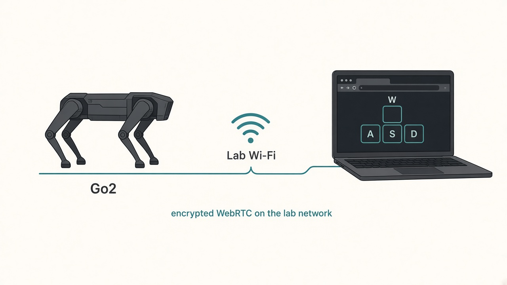
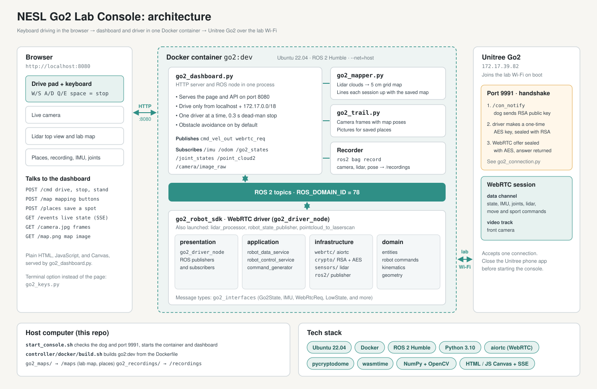
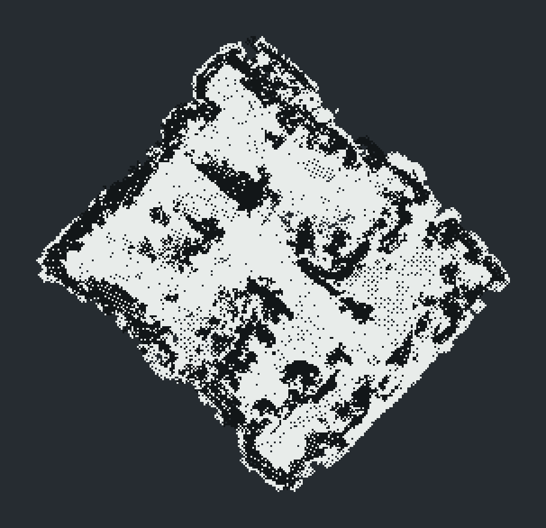
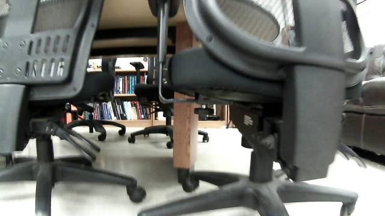
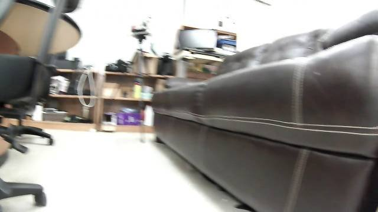
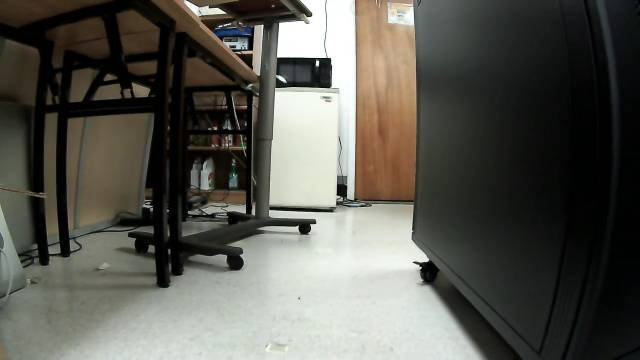

# NESL Go2 Lab Console

Keyboard driving, live sensors, and a lidar map for a Unitree Go2, from the [Networked & Embedded Systems Laboratory](https://nesl.github.io/) at UCLA.

**Authors:** Khang Nguyen and Oliver Wang, [NESL](https://nesl.github.io/), UCLA

The computer and the dog sit on the same lab Wi-Fi. The dog joins that Wi-Fi by itself when it is powered on. `./start_console.sh` opens the encrypted session and the web page.

<p align="center">
  
</p>

## Architecture

<p align="center">
  
</p>

The browser sends keyboard moves to `go2_dashboard.py` over HTTP. The dashboard turns them into ROS 2 messages. The driver in `controller/go2_robot_sdk` sends those messages to the dog over an encrypted WebRTC session on the lab Wi-Fi. Sensor data comes back along the same path to the page.

<p align="center">
  
</p>

Views from the dog's front camera, saved with the lab places:

<p align="center">
  
  
  
</p>

This is a Linux setup. Ubuntu 22.04 is what the image is built from. Docker Desktop on Windows or macOS does not give the container the computer's Wi-Fi (`--net=host` does not work there). On Windows, use Ubuntu 22.04 inside WSL2, as in the section below.

The dog in this lab is `172.17.39.82`. Another dog: `ROBOT_IP=x.x.x.x ./start_console.sh`.

## Windows

Use Windows 11. Windows 10 cannot give WSL the lab Wi-Fi address, so the dog stays unreachable.

1. Join the lab Wi-Fi in Windows. Power the dog on and leave the Unitree app closed.
2. In PowerShell as Administrator: `wsl --install -d Ubuntu-22.04`. Reboot if Windows asks.
3. Create `C:\Users\<you>\.wslconfig` with:

```ini
[wsl2]
networkingMode=mirrored
```

4. In PowerShell: `wsl --shutdown`, then open Ubuntu 22.04 from the Start menu.
5. Inside Ubuntu, prove the dog is visible before installing anything else:

```bash
ping -c1 172.17.39.82
nc -z -w1 172.17.39.82 9991 && echo "WebRTC port open"
```

If ping fails, stop. The rest of this repo cannot reach the dog from that Windows machine. Mirrored networking is what makes the Ubuntu terminal use the Windows Wi-Fi adapter.

6. Install Docker **inside** that Ubuntu (the steps in the next section). Do not use Docker Desktop. Desktop's Linux engine ignores `--net=host`, so the container would not be on the lab Wi-Fi.
7. Clone this repo inside the Ubuntu home directory, not under `/mnt/c`. Then run `./controller/docker/build.sh` and `./start_console.sh` from there.
8. On the Windows desktop, open http://localhost:8080. Mirrored mode forwards that port from Ubuntu.

From here, follow sections 1–3 inside the Ubuntu terminal.

## 1. Install Docker

On the Linux computer:

```bash
sudo apt update
sudo apt install -y docker.io git
sudo usermod -aG docker "$USER"
```

Log out and back in so the `docker` group applies. Check with `docker ps` (it should not ask for sudo).

## 2. Build the driver image

From this folder, once:

```bash
./controller/docker/build.sh
```

That runs `docker build` on `controller/docker/Dockerfile` and tags the image `go2:dev`. The first build downloads ROS 2 Humble and compiles the driver. Expect 15–30 minutes and a network connection.

The Dockerfile installs, in order:

| Piece | Why it is there |
| --- | --- |
| ROS 2 Humble (`ros:humble-ros-base-jammy`) | The driver publishes lidar, camera, IMU, feet, and joints |
| `controller/go2_interfaces` | The ROS messages, copied from this repo |
| `controller/go2_robot_sdk` | The WebRTC driver, copied from this repo |
| `lidar_processor` from [go2_ros2_sdk](https://github.com/abizovnuralem/go2_ros2_sdk) | `robot.launch.py` starts it, and that package is not in this folder |
| `aiortc`, `pycryptodome`, `wasmtime` | Encrypted session to the dog, and lidar decoding |
| OpenCV, cv_bridge | Camera frames and the map on the web page |

`controller/docker/requirements.txt` is the Python list. Do not add a newer `numpy` on top: ROS Humble is built against Ubuntu's numpy.

The image recipe in the upstream [docker folder](https://github.com/abizovnuralem/go2_ros2_sdk/tree/master/docker) clones that whole project and is aimed at joystick, Nav2, and SLAM. This Dockerfile builds only what `./start_console.sh` runs, using the driver in this folder.

## 3. Lab Wi-Fi, then the console

1. Power the dog on. It connects to the lab Wi-Fi on its own. Leave the Unitree phone app closed. The dog accepts one program at a time.
2. Join the **same** lab Wi-Fi on this computer. A phone hotspot or a guest network will not reach the dog.
3. Confirm you are on the lab subnet before starting. The dog is `172.17.39.82`, so this computer should also have an address in `172.17.0.0/18`:

```bash
ip -4 addr
ping -c1 172.17.39.82
nc -z -w1 172.17.39.82 9991 && echo "WebRTC port open"
```

`ping` shows the dog is on the Wi-Fi. Port **9991** is the dog's signaling port. `start_console.sh` checks both and stops if either fails.

4. Start the console:

```bash
./start_console.sh
```

Open **http://localhost:8080**. Tick **Enable driving**, click the page, and hold keys:

| Key | Motion |
| --- | --- |
| W / S | forward / back |
| A / D | strafe left / right |
| Q / E | turn left / right |
| space | stop |
| R / F | look up / down |

Letting go of a movement key stops the dog within 0.3 s. Max 0.3 m/s forward, 0.2 m/s sideways. Keep someone next to the dog.

`./start_console.sh --reset` restarts the driver. If an older container named `go2_test` is still running, stop it first: `docker stop go2_test`.

## How the connection stays on the lab network

The container is started with `--net=host`, so it uses this computer's Wi-Fi address and talks to the dog directly. It does not go out through a cloud relay.

The session itself is encrypted. The driver asks the dog for its RSA public key on port 9991 (`/con_notify`), encrypts a one-time AES key with that public key, and encrypts the WebRTC session description with the AES key. Camera, lidar, and drive commands travel on that WebRTC session. See `controller/go2_robot_sdk/go2_robot_sdk/infrastructure/webrtc/go2_connection.py`.

The web page refuses drive commands from outside localhost and the lab subnet `172.17.0.0/18`. A browser on this computer is allowed. A laptop on the same lab Wi-Fi can open `http://<this-computer-ip>:8080` and drive. A machine on another network cannot. For a different subnet, remove the old container (`docker rm -f go2_khang`) and start again with `GO2_CONTROL_NETS=127.0.0.0/8,10.0.0.0/24 ./start_console.sh`. Do not publish ports 8080 or 9991 on the public internet.

`ROS_DOMAIN_ID=78` keeps this ROS graph off the default domain, so other ROS machines on the lab Wi-Fi do not mix in.

## The map

If `go2_maps/lab.grid.npz` is present, the robot loads that lab map (23 Oct 2026). Named spots are `go2_maps/lab.places.json`. Without those files the page still starts; use **Start mapping** on the page and drive slowly.

After a reboot the dog's odometry starts over. On the console, use **Line up again** before you trust the pose on a saved map.

## The controller

`controller/go2_robot_sdk` is the WebRTC driver. `controller/go2_interfaces` is the messages it publishes. `controller/docker` is the image recipe above. The page is `go2_dashboard.py`. The map comes from `go2_mapper.py`.
